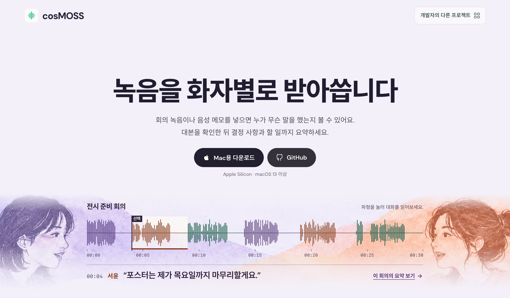

# cosMOSS

회의나 인터뷰 녹음을 내 Mac 또는 개인 SSH 서버에서 화자별로 받아씁니다. 목소리를 확인해 이름을 붙이고, Codex나 Claude로 결정 사항과 할 일을 요약할 수 있어요.

**[파형을 눌러 화자별 대본 읽어보기 ↗](https://cosmoss-app.pages.dev/)**

[사용 가이드](docs/USAGE.md) · [개발 가이드](docs/DEVELOPMENT.md) · [원작과 오픈소스](THIRD_PARTY_NOTICES.md)
