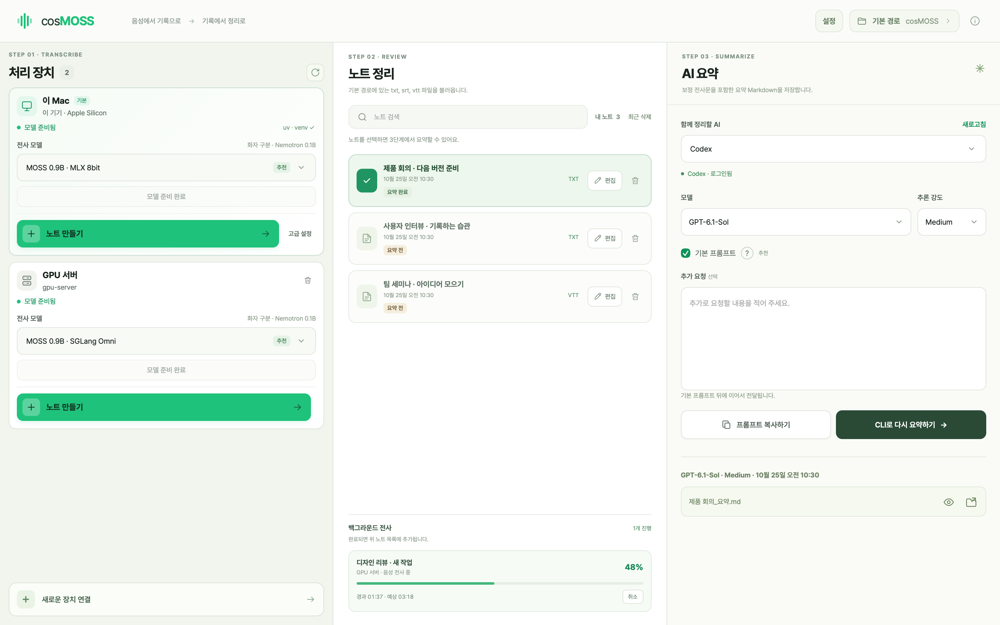
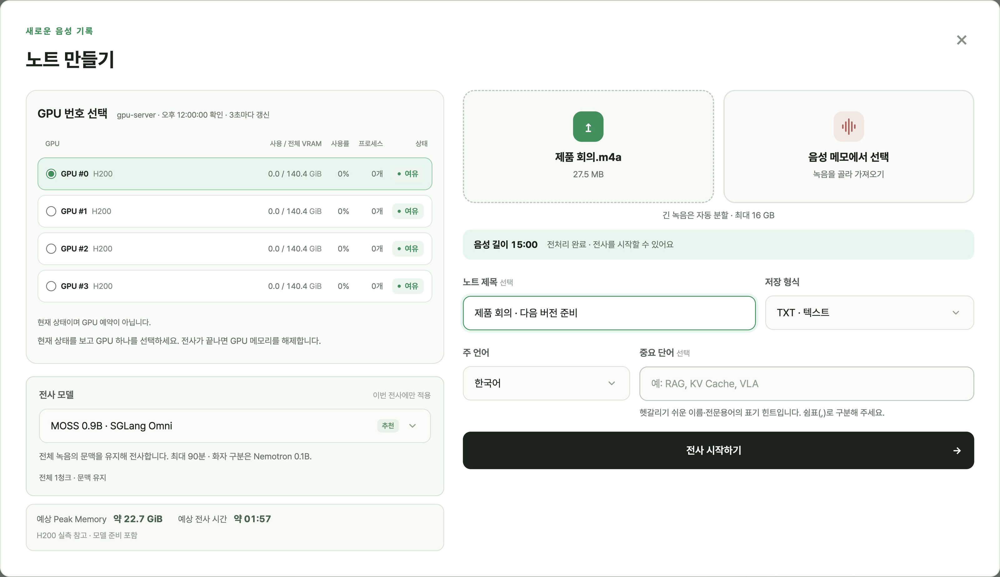
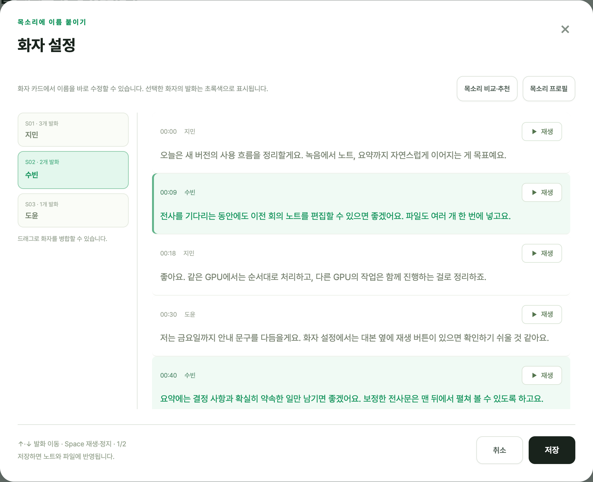

# cosMOSS

**대화는 흘러가도, 기록은 남도록.**

녹음을 텍스트로 옮기고, 목소리에 이름을 붙이고, 필요한 내용을 요약합니다.
회의·인터뷰·강의가 끝난 뒤의 정리를 한 화면에서 이어 가는 Mac 앱입니다.

외부 전사 서비스 없이, Mac 온디바이스 또는 내 SSH 서버에서 처리합니다.

Apple Silicon · macOS 13 이상

현재 앱 화면 · 노트와 대화는 사용 흐름을 보여 주기 위한 예시입니다.

## 녹음을 맡기세요

파일이나 Mac의 음성 메모에서 녹음을 골라 가져오세요. 여러 녹음도 한 번에 등록할 수 있습니다.
전사는 백그라운드에서 진행됩니다. 기다리는 동안 다른 노트를 정리해도 괜찮습니다.

내 Mac에서 바로 시작하거나, SSH로 연결한 NVIDIA GPU 서버를 사용할 수 있습니다.

## 듣고, 확인하고, 이름을 붙이세요

대본 옆 재생 버튼으로 목소리를 확인하고, 화자 카드에서 이름을 바로 고치세요.
방향키로 발화를 이동하고 **Space**로 재생·정지합니다. 같은 목소리는 드래그로 합칠 수 있습니다.

실제 발언이 아닌 가상 대화 예시입니다.

## 다음에 읽기 좋은 기록으로 남기세요

**Codex·Claude**로 전사문을 검토하고 핵심 내용과 할 일을 정리하세요.
원하는 모델과 추론 강도를 고르거나, 프롬프트를 복사해 다른 AI에서도 사용할 수 있습니다.
요약은 Markdown으로 저장하고, 보정된 전사문은 문서 맨 뒤에서 펼쳐 봅니다.

전사 파일은 **TXT·SRT·VTT**로 보관합니다. 기존 파일도 편집·변환할 수 있고,
앱에서 삭제한 노트는 **최근 삭제**에서 7일 동안 복구할 수 있습니다.

## 처음이라면

1. [Mac용 DMG](https://github.com/hoonably/cosMOSS/releases/download/v1.0.0/cosMOSS-v1.0.0-macos-arm64.dmg)를 열고 **cosMOSS**를 **응용 프로그램**으로 옮기세요.
2. 첫 실행 안내에 따라 접근 권한을 허용하고, **설정 → 준비하기**로 도구를 준비하세요.
3. 사용할 Mac이나 서버에서 모델을 준비한 뒤 **노트 만들기**를 누르세요.

서버만 사용한다면 Mac용 모델은 설치하지 않아도 됩니다.
CLI 요약은 이 Mac에 설치하고 로그인한 Codex·Claude 계정을 사용합니다.
음성과 노트는 Mac에 보관하며, 원격 전사·AI 요약 시 선택한 장치·서비스로 필요한 내용을 전달합니다.

## 업데이트와 권한

**cosMOSS → 업데이트 확인…**에서 현재 버전과 새 버전을 확인하세요.
**새 버전 자동 알림**과 **자동 다운로드 및 설치**는 따로 선택할 수 있고, 선택은 다음 실행에도 유지됩니다.
처음 설치하면 알림만 켜져 있으며 설치는 직접 선택합니다. 기존 사용자가 저장한 설정은 유지합니다.

첫 실행의 권한 안내는 시스템 설정 옆에 열립니다. 안내의 앱 아이콘을 **전체 디스크 접근 권한** 목록으로 옮긴 뒤 스위치를 켜세요.
권한은 macOS에서 직접 허용하며, 설정에서 돌아오면 접근 상태를 다시 확인합니다.

## 개발·배포 안내

직접 실행하거나 수정하려면 [개발 가이드](docs/DEVELOPMENT.md),
배포를 준비하려면 [릴리스 가이드](docs/RELEASING.md)를 참고하세요.

## Credits

[JoNebula/moss-note](https://github.com/JoNebula/moss-note), [jiseungjeong/moss-note](https://github.com/jiseungjeong/moss-note), [ginjae/mac-moss](https://github.com/ginjae/mac-moss)를 바탕으로 만들었습니다.

전사에는 [MOSS](https://huggingface.co/OpenMOSS-Team/MOSS-Transcribe-Diarize)·[Qwen3-ASR](https://huggingface.co/Qwen/Qwen3-ASR-1.7B), 화자 구분에는 [Nemotron](https://huggingface.co/nvidia/Nemotron-3-Diarization)을 사용합니다.

[MIT License](https://github.com/hoonably/cosMOSS/blob/main/LICENSE) · [문제 제보](https://github.com/hoonably/cosMOSS/issues)
