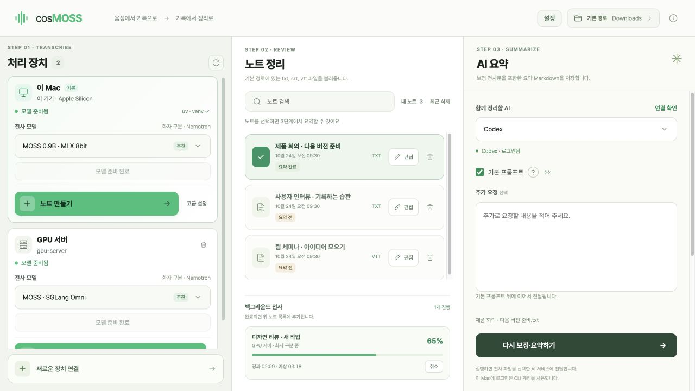
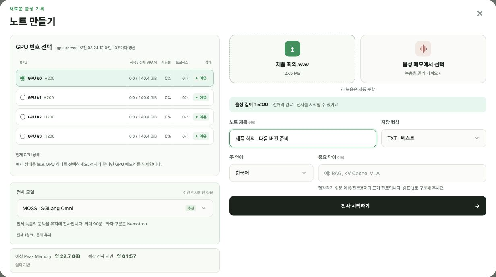
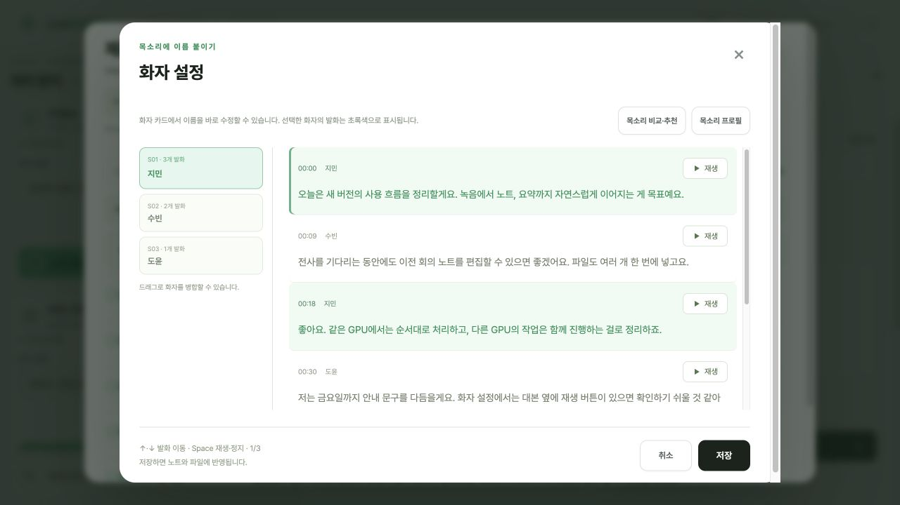

# cosMOSS

**대화는 흘러가도, 기록은 남도록.**

녹음을 텍스트로 옮기고, 목소리에 이름을 붙이고, 필요한 내용을 요약합니다.
회의·인터뷰·강의가 끝난 뒤의 정리를 한 화면에서 이어 가는 Mac 앱입니다.

Apple Silicon · macOS 13 이상 · [웹사이트](https://hoonably.github.io/cosMOSS/) · [릴리스 노트](https://github.com/hoonably/cosMOSS/releases/tag/v1.0.0)

1.0.0 화면 · 캡처의 노트와 대화는 사용 흐름을 보여 주기 위한 예시입니다.

## 녹음에서 노트까지

### 01. 녹음을 맡기세요

파일을 끌어 놓거나 Mac의 음성 메모에서 골라 가져오세요. 여러 녹음을 체크해 한 번에 등록할 수도 있습니다.
전사는 백그라운드에서 진행됩니다. 기다리는 동안 다른 노트를 편집하거나 요약해도 괜찮습니다.

Mac에서는 **MOSS MLX + Nemotron**, SSH로 연결한 NVIDIA 서버에서는 다음 세 가지 방식을 사용합니다.

| 전사 방식 | 이런 때 골라 보세요 |
| --- | --- |
| **MOSS · SGLang Omni** | 긴 대화의 문맥을 유지하며 전사할 때. 서버 기본값입니다. |
| **Qwen · Transformers** | 약 3분씩 전사하고 단어 시간을 정렬하는 빠른 처리가 필요할 때. |
| **MOSS + Qwen** | MOSS 본문에 Qwen 보조 대본을 더해 표현을 비교하고 싶을 때. |

화자 구분은 Mac과 서버 모두 **Nemotron**이 맡습니다. 노트 만들기에서 모델과 예상값을 확인하고 이번 작업에 사용할 방식을 바꿀 수 있습니다.
같은 Mac·GPU에 등록한 녹음은 순서대로, 서로 다른 GPU의 작업은 동시에 처리합니다.

### 02. 듣고, 확인하고, 이름을 붙이세요

대본 옆 재생 버튼으로 실제 목소리를 확인하고, 화자 카드에서 이름을 바로 고치세요.
방향키로 발화를 이동하고 **Space**로 재생·정지할 수 있습니다. 여러 화자로 나뉜 같은 목소리는 드래그해 합칩니다.

목소리 프로필을 등록하면 이름과 병합 후보를 추천받을 수 있습니다. 추천은 직접 검토해 승인한 항목만 반영합니다.
필요하면 Nemotron이나 pyannote Community-1으로 화자를 다시 분리한 뒤 변경 전후를 비교할 수도 있습니다.

노트는 선택한 **TXT·SRT·VTT** 형식으로 자동 저장합니다. 기존 전사 파일도 불러와 편집하거나 다른 형식으로 변환할 수 있습니다.
삭제한 노트는 **최근 삭제**에서 7일 동안 복구할 수 있고, 목록에서는 요약 전·완료·다시 요약할 노트를 구분해 보여 줍니다.

### 03. 다음에 읽기 좋은 기록으로 남기세요

**Codex·Claude**로 전사문의 인식 오류를 검토하고, 대화 흐름에 따라 핵심 내용·결정 사항·명시적으로 약속한 할 일을 정리합니다.
결과는 Markdown 문서 하나로 저장하며, 보정된 전사문 전체는 문서 맨 뒤에서 펼쳐 볼 수 있습니다.

기본 프롬프트는 직접 수정하고 추천 문구로 되돌릴 수 있습니다. 이번 노트에만 필요한 요청은 아래에 덧붙이세요.
AI 요약에는 이 Mac에 설치하고 로그인한 Codex 또는 Claude CLI가 필요합니다.

## 처음이라면

1. [Mac용 DMG](https://github.com/hoonably/cosMOSS/releases/download/v1.0.0/cosMOSS-v1.0.0-macos-arm64.dmg)를 열고 **cosMOSS**를 **응용 프로그램** 폴더로 드래그합니다.
2. 앱의 안내에 따라 **전체 디스크 접근 권한**을 허용하고, **설정 → 준비하기**로 파일 처리 도구를 준비합니다. FFmpeg도 함께 준비됩니다.
3. 처리 장치에서 모델을 선택한 뒤 **선택한 모델 다운로드 → 노트 만들기**로 시작합니다.

서버만 사용한다면 **새로운 장치 연결**로 서버를 먼저 추가하세요. Mac용 전사 모델을 설치할 필요는 없습니다.
모델 선택이나 서버 연결만으로 다운로드가 시작되지는 않으며, 이미 준비된 환경과 모델은 재사용합니다.

macOS가 실행을 차단하면 **시스템 설정 → 개인정보 보호 및 보안 → 확인 없이 열기**에서 허용하세요.
첫 도구·모델 다운로드에는 인터넷 연결이 필요합니다.

## 기록이 머무는 곳

음성과 노트는 이 Mac에 보관합니다. 서버에서 전사할 때는 선택한 서버로 음성을 보내고, AI 요약을 실행할 때는 선택한 AI 서비스에 전사 내용을 전달합니다.

[사용 안내](docs/USAGE.md) · [개발 안내](docs/DEVELOPMENT.md) · [문제 제보](https://github.com/hoonably/cosMOSS/issues)

## Credits

[JoNebula/moss-note](https://github.com/JoNebula/moss-note), [jiseungjeong/moss-note](https://github.com/jiseungjeong/moss-note), [ginjae/mac-moss](https://github.com/ginjae/mac-moss)를 바탕으로 만들었습니다.

전사에는 [MOSS-Transcribe-Diarize](https://huggingface.co/OpenMOSS-Team/MOSS-Transcribe-Diarize)·[Qwen3-ASR](https://huggingface.co/Qwen/Qwen3-ASR-1.7B), 화자 구분에는 [Nemotron 3 Diarization](https://huggingface.co/nvidia/Nemotron-3-Diarization)·[pyannote Community-1](https://huggingface.co/pyannote/speaker-diarization-community-1)을 사용합니다.

[MIT License](LICENSE) · [Third-party notices](THIRD_PARTY_NOTICES.md)
