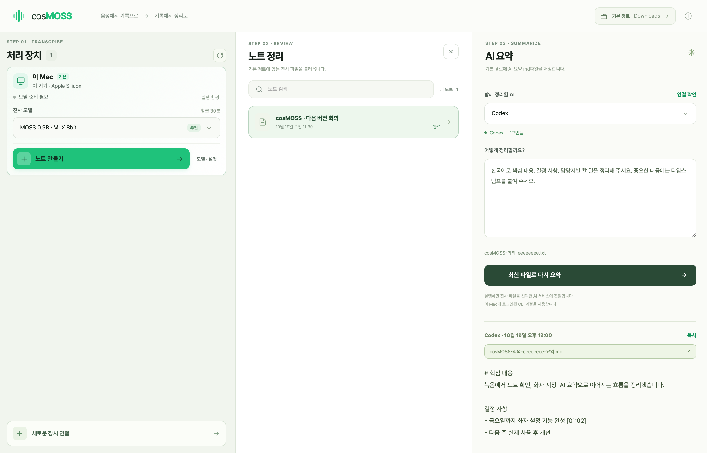

# cosMOSS

**녹음을 기록으로, 기록을 다음 할 일로.**

Local-first transcription and speaker diarization for Mac.

cosMOSS는 회의, 인터뷰, 강의 녹음을 텍스트로 옮기는 Mac 앱입니다.
이 Mac에서 음성을 처리하고, 누가 언제 말했는지 구분한 기록을 읽고 편집할 수 있습니다.



## 주요 기능

- **Mac에서 전사** — Apple Silicon과 MLX로 로컬 음성 처리
- **화자 구분과 타임스탬프** — 발언자별로 읽고, 해당 구간의 음성 재생
- **긴 녹음 지원** — 자동 분할과 구간 경계의 화자 연결
- **노트 편집** — 본문 수정과 검색, 화자별 발언 강조와 이름 지정
- **형식 선택** — TXT·SRT·VTT로 저장하고 편집·화자 병합·요약에 사용
- **기존 전사 파일 열기** — 기본 경로의 TXT·SRT·VTT 자동 표시, 원문 편집과 요약
- **AI 요약** — 로그인한 Codex·Claude CLI로 전사 파일을 정리하고 Markdown 저장
- **내보내기** — TXT, SRT, WebVTT, JSON
- **다른 장치 연결** — 필요할 때 다른 Mac이나 NVIDIA GPU 기기로 전사

MP3, WAV, M4A, MP4 등 음성·영상 파일을 사용할 수 있습니다.
파일 기반 전사를 지원하며, 마이크 녹음은 지원하지 않습니다.

## 시작하기

Apple Silicon Mac, macOS 13 이상이 필요합니다.

### Mac 앱 다운로드

[Releases](https://github.com/hoonably/cosMOSS/releases)에서 `cosMOSS-v0.1.0-macos-arm64.zip`을 내려받고,
압축을 푼 `cosMOSS.app`을 **응용 프로그램** 폴더에 옮겨 실행하세요.
Python과 uv, 앱 소스가 포함되어 있어 저장소를 복제할 필요가 없습니다.
음성 파일 변환에 사용하는 FFmpeg는 별도로 설치합니다.

```bash
brew install ffmpeg
```

첫 실행 후 앱에서 모델과 MLX 실행 환경을 준비합니다. 이때 인터넷 연결이 필요합니다.
현재 프리릴리스는 Developer ID 서명·공증 없이 배포됩니다.
macOS가 실행을 차단하면 **시스템 설정 → 개인정보 보호 및 보안 → 확인 없이 열기**에서 허용하세요.
Codex·Claude 요약 기능은 해당 CLI 설치와 로그인이 필요합니다.

### 소스에서 실행

소스 빌드에는 Xcode Command Line Tools가 추가로 필요합니다.

```bash
brew install uv ffmpeg
git clone https://github.com/hoonably/cosMOSS.git
cd cosMOSS
cp .env.example .env
./scripts/setup-app.sh
./scripts/build-mac-app.sh
```

모델은 앱을 연 뒤 준비할 수 있습니다.

### 실행

앱을 엽니다.

```bash
open dist/cosMOSS.app
```

화면은 왼쪽부터 세 단계로 구성됩니다.
기본 너비는 **1:1:1**이며, 영역 사이 경계선을 드래그해 조절할 수 있습니다.
조절한 비율은 다음 실행에도 유지됩니다. 경계선을 두 번 클릭하면 균등한 너비로 돌아갑니다.

1. **처리 장치** — 이 Mac의 **모델·설정**에서 모델을 준비한 뒤 **노트 만들기**로 녹음을 선택합니다.
2. **노트 정리** — 기본 경로의 TXT·SRT·VTT를 열어 본문을 다듬습니다. **화자 설정**에서 화자를 누르면 해당 발언 전체가 빨간색으로 표시됩니다. 이름을 지정하거나 다른 화자 위로 드래그해 병합할 수 있습니다. 병합 확인 후 **저장**하면 노트와 선택한 형식의 파일이 함께 갱신됩니다. **Finder에서 보기**로 실제 파일을 찾을 수 있습니다.
3. **AI 요약** — Codex 또는 Claude와 요약 요청을 선택하고 **Markdown으로 요약하기**를 누릅니다. 결과는 기본 경로에 `.md`로 저장되며, 본문이 바뀌면 다시 요약할 수 있습니다.

기본 캐시에 모델이 있으면 재사용하고, 없으면 다운로드합니다. 직접 선택한 폴더는 복사하지 않습니다.
노트 만들기 창에서는 TXT·SRT·VTT 저장 형식을 선택합니다. 처리 장치와 청크 길이는 1단계에서 고른 설정을 사용하며, NVIDIA 장치의 GPU는 실행할 때 선택합니다.

실행 환경과 모델은 앱에서 준비하며, 다음 실행부터 저장한 모델을 자동으로 불러옵니다.

언어와 중요 단어는 새 노트 창에서, 녹음 분할 길이는 장치별 고급 처리 설정에서 조정할 수 있습니다.

## 모델과 처리 설정

메인 화면에서 장치별로 전사 모델을 선택할 수 있습니다.

| 장치 | 선택 가능한 MOSS 모델 |
| --- | --- |
| Apple Silicon Mac | MLX 4bit, 8bit, 원본 16bit |
| NVIDIA GPU | 원본 BF16/FP16, 텍스트 디코더 8bit/4bit 양자화(실험적) |

Mac은 메모리 용량, NVIDIA 장치는 GPU별 VRAM을 읽어 시작 설정을 추천합니다.
추천은 녹음 길이와 실제 메모리 사용량을 보장하는 값이 아니며, **권장값 적용**을 눌러 선택할 수 있습니다.
GPU 메모리가 큰 경우에도 같은 0.9B 모델을 사용하며, 더 긴 청크를 처리할 여유가 생깁니다.
NVIDIA 양자화는 원본 Hugging Face 캐시를 재사용하고 로딩할 때 적용합니다.

**모델·설정 → 고급 처리 설정**에서 청크 길이, 화자 연결 구간, 최대 출력 토큰을 조절합니다.
Mac은 KV 캐시와 prefill 묶음 크기, NVIDIA는 정밀도·Attention·KV 캐시 사용을 추가로 설정합니다.
설정은 장치별로 저장되고, 시작한 노트에는 당시 설정이 고정됩니다.
2단계에서는 TXT·SRT·VTT를 세로 목록으로 탐색합니다. 노트를 누르면 넓은 편집 창이 열리고, 닫아도 선택이 유지되어 3단계에서 바로 요약할 수 있습니다.

호환되는 MOSS 저장소 ID도 직접 지정할 수 있습니다. 별도 엔진이 필요한 GGUF/CoreML/ONNX 변환본과
영어 ASR 전용 2B preview는 현재 실행하지 않으며 선택 목록에 사유를 표시합니다.

## 다른 장치 사용하기

기본은 이 Mac입니다. 필요하면 장치 화면의 **다른 장치 연결**을 펼쳐
SSH로 다른 기기를 추가하면 실행 환경과 모델을 자동으로 준비합니다. 이미 설치된 항목은 재사용하고, 모델은 기본 Hugging Face 캐시에 저장합니다. 장치의 실행 환경 버튼에서 uv·Python venv·패키지 상태를 확인하거나 수동으로 설치할 수 있습니다. 모델 설정에서는 기존 모델 폴더도 지정할 수 있습니다.
다운로드 진행률과 용량은 1초마다 갱신됩니다. NVIDIA GPU는 전사를 시작할 때 선택합니다.

연결과 모델 준비에 관한 자세한 내용은 [장치 연결 안내](docs/DEVICES.md)를 참고하세요.

## Codex·Claude 연결

이 Mac에 설치되고 로그인된 최신 CLI를 사용합니다. 둘 중 원하는 것을 준비한 뒤
앱의 **AI 요약 → 연결 확인**을 누르세요. 미설치·미로그인 상태는 화면에 안내합니다.

| CLI | 설치 | 로그인 |
| --- | --- | --- |
| [Codex](https://developers.openai.com/codex/cli/) | `npm install -g @openai/codex` | `codex login` |
| [Claude Code](https://code.claude.com/docs/en/quickstart) | `brew install --cask claude-code` | `claude auth login` |

실행할 때 선택한 형식으로 편집본을 저장하고 그 내용을 CLI에 전달합니다. 기존 TXT·SRT·VTT는 원본 파일을 읽습니다. 요약 요청을 직접 수정할 수 있고,
실행 중 취소할 수도 있습니다. 결과는 실행할 때 선택된 기본 경로에 `원본파일명-요약.md`로 저장하며, 같은 이름의 파일이 있으면 번호를 붙여 보존합니다. 앱에서 다시 볼 수 있도록 `data/summaries/`에도 노트별로 보관합니다.
실행 후 노트가 수정되면 이전 내용으로 만든 요약이라는 안내가 표시됩니다.

## 데이터와 설정

기본 설정에서는 음성과 노트를 이 Mac에서 처리하고 보관합니다.
다른 장치를 직접 선택한 경우에만 해당 기기로 음성을 전송합니다.
앱이 관리하는 NVIDIA 장치에서는 전사 결과를 이 Mac에 저장한 뒤 임시 음성·로그·작업 파일·설치 캐시를 정리합니다.
모델과 전용 Python venv 실행 환경은 다음 작업에서 재사용합니다. Conda 환경은 만들지 않습니다.
AI 요약을 실행하면 전사 파일 내용이 선택한 AI 서비스로 전송되며 해당 CLI 계정의 이용 조건과 사용량이 적용됩니다.

파일을 저장하고 불러오는 기본 경로는 이 Mac의 Downloads 폴더입니다. 상단 오른쪽 **기본 경로**를 눌러 변경할 수 있으며, 다음 앱 실행에도 유지됩니다. 이 폴더의 TXT·SRT·VTT를 불러오고, 선택한 형식의 전사 파일과 AI 요약 Markdown을 저장합니다.
선택한 폴더의 기존 `.txt`·`.srt`·`.vtt` 파일도 2단계에 표시됩니다. 목록은 5초마다 갱신하며, 원본 파일을 복사하거나 열기만으로 변경하지 않습니다. 기존 파일은 바로 편집·요약할 수 있고, `[시:분:초] 화자: 내용` 형식이면 화자 이름도 지정할 수 있습니다. UTF-8·BOM이 있는 UTF-16·CP949를 지원하며, 편집할 때 원래 인코딩을 유지합니다. 자막의 화자 이름 지정·병합은 cue ID, 시간, 자막 설정과 본문을 보존합니다.
**TXT/SRT/VTT 저장**, **화자 설정 → 저장**, **Finder에서 보기**, **요약 실행**에서 선택한 형식의 파일이 처음 생성됩니다.
그 뒤 본문과 화자 이름을 편집하면 같은 파일이 갱신됩니다. 폴더 변경은 새 전사 파일에 적용됩니다.
다른 앱에서 수정한 파일은 덮어쓰지 않고 알립니다. 앱에서 노트를 삭제해도 외부에 저장한 전사 파일과 Markdown은 남습니다.

배포용 앱의 녹음·노트·장치 설정과 실행 환경은 `~/Library/Application Support/cosMOSS/`에 저장됩니다.
소스에서 실행하면 녹음·노트·장치 설정은 저장소의 `data/`에 저장됩니다. 앱을 종료한 뒤 해당 폴더를 백업할 수 있습니다.
로컬 모델은 Hugging Face 기본 캐시(`~/.cache/huggingface/hub`) 또는 직접 선택한 폴더에서 불러옵니다.
`HF_HUB_CACHE` / `HF_HOME` 설정도 따릅니다. 녹음과 모델은 Git에 포함하지 않습니다.
추가 설정은 [.env.example](.env.example)을 참고하세요.

## 개발

```bash
.venv/bin/python -m unittest discover -s tests -v
node --check static/app.js
```

앱 구조, 실행 방식과 검증 방법은 [개발 안내](docs/DEVELOPMENT.md)에 정리되어 있습니다.

## Credits

[ginjae/mac-moss](https://github.com/ginjae/mac-moss)를 바탕으로 시작했으며,
[JoNebula/moss-note](https://github.com/JoNebula/moss-note)와
[jiseungjeong/moss-note](https://github.com/jiseungjeong/moss-note)의 작업을 이어갑니다.
전사와 화자 구분에는 OpenMOSS의 MOSS 모델을 사용합니다.

소스 코드는 [MIT License](LICENSE)로 배포합니다.
모델과 외부 구성 요소의 출처·라이선스는 [Third-party notices](THIRD_PARTY_NOTICES.md)를 참고하세요.
