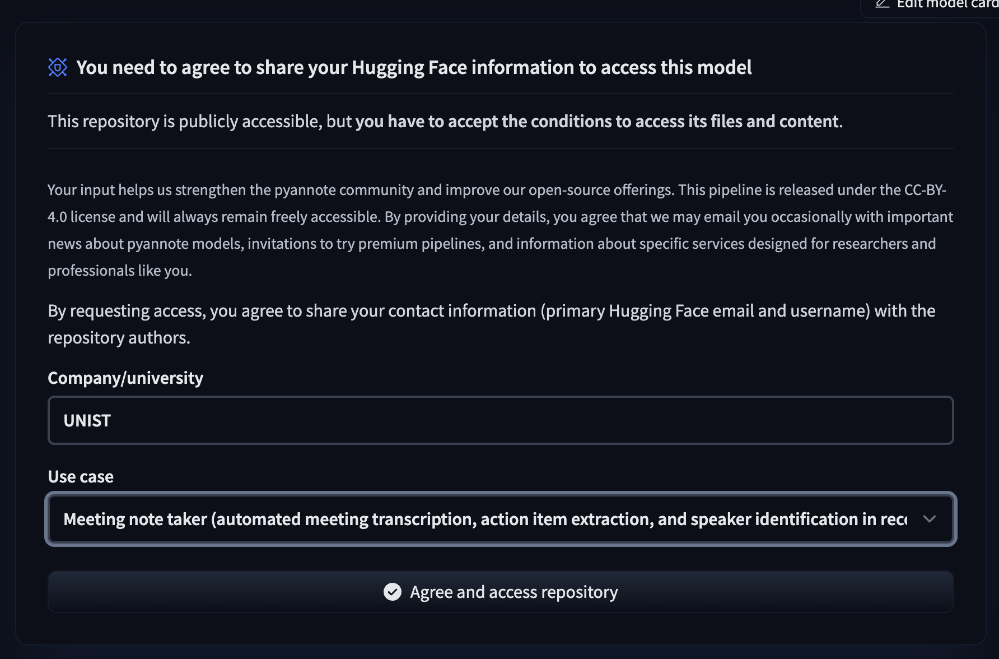

# 사용 안내

## 서버 전사 방식

장치를 연결한 뒤 왼쪽 처리 장치에서 전사 모델을 선택하고 **선택한 모델 다운로드**를 누릅니다.
연결과 모델 선택은 다운로드를 시작하지 않습니다. 모델 준비가 끝나면 **노트 만들기**에서 GPU 번호를 고릅니다.

| 순서 | 방식 | 선택 기준 |
|---|---|---|
| 1 | MOSS · 빠른 전사 | 기본 추천. 약 3분의 청크를 묶어 동시에 전사하고 Nemotron으로 전체 녹음의 화자를 구분합니다. |
| 2 | Qwen3-ASR · 속도 우선 | 별도의 시간 정렬 모델과 Nemotron을 함께 사용합니다. 실측상 더 빠르지만 메모리를 더 사용하며 단어 시간 표시를 확인해야 합니다. |
| 3 | MOSS · 긴 문맥 | 기존 방식. 긴 청크를 순서대로 처리해 문맥을 유지합니다. 필요하면 완료 후 화자를 재분리합니다. |

위 순서는 속도·메모리·기능을 고려한 사용 권장 순서입니다. 한국어 정확도 순위가 검증된 것은 아닙니다.
같은 65분 37초 녹음의 [실측 비교와 품질 한계](performance/2026-10-21-h200-asr-comparison.md)를 참고하세요.

빠른 전사의 **동시 청크 수**는 청크를 GPU에 한꺼번에 넣는 개수입니다. 녹음을 나누는 총 개수와 다릅니다.
자동 설정은 여유를 포함한 예상 Peak Memory가 전체 VRAM의 70% 이내가 되는 범위에서 추천합니다.
최대 24개까지 묶고, 나머지는 다음 묶음으로 처리합니다. 동시에 처리하는 수를 늘린다고 같은 비율로 빨라지지는 않습니다.
70%를 넘으면 경고를 확인해야 시작할 수 있고, 전체 VRAM을 넘는 예상값은 동시 청크 수를 줄여야 합니다.
다른 프로세스의 현재 메모리 사용량도 별도로 확인하세요.

왼쪽의 다운로드 버튼을 누르면 필요한 모델과 실행 도구를 선택한 서버의 별도 환경에 준비합니다. 이미 준비된 모델은 재사용합니다.
노트 만들기 창은 왼쪽에서 선택한 모델을 그대로 사용하며, 전사 중에 다른 모델을 자동으로 다운로드하지 않습니다.
원격 전사만 사용하면 Mac에 MOSS·Qwen 가중치를 설치하지 않습니다. 첫 다운로드 시간은 예상 처리 시간에 포함되지 않습니다.
H200 기준값은 다른 GPU의 속도로 대입하지 않습니다. 새 GPU는 첫 성공한 실행부터 같은 모델·동시 청크 수의 실제 기록을 이용합니다.

새 빠른 전사의 초기 화자는 Nemotron으로 표시됩니다. 겹쳐 말했거나 음성과 맞지 않는 구간은 **미확인**으로 남깁니다.
Qwen의 시간이 0초인 단어는 해당 시점에 화자가 한 명만 말하고 있을 때만 연결합니다. 가까운 화자를 임의로 붙이지 않습니다.
원래 ASR 문자열과 단어 시간은 노트의 내부 진단 파일에 보존합니다. 이후 화자 재분리와 목소리 이름 추천은 기존처럼 검토 후 선택한 항목만 승인합니다.
완료 화면에서 실제 모델 처리 시간·Peak Memory·동시 청크 수·미확인 발화 수를 확인할 수 있습니다.

서버 작업은 취소·연결 종료 시 해당 작업의 프로세스만 종료하고 GPU 메모리와 서버의 임시 음성 사본을 정리합니다.

[← cosMOSS](../README.md)

## 첫 실행 권한 설정

Mac 앱은 **전체 디스크 접근 권한**을 확인한 뒤 작업 화면을 엽니다.
허용하기 전에는 파일 처리 서비스와 Downloads 목록 읽기를 시작하지 않습니다.

1. 첫 화면에서 **권한 설정하기**를 누릅니다.
2. 설정 옆 안내 창의 cosMOSS 아이콘을 **전체 디스크 접근 권한** 목록으로 드래그하고 스위치를 켭니다.
3. **완료**를 누르거나 앱으로 돌아오면 다시 확인합니다. 여전히 첫 화면이면 **앱 다시 시작**을 누르세요.

전체 디스크 접근에는 Downloads 폴더 접근이 포함되므로, 정상 적용되면 별도의 Downloads 허용 팝업은 필요하지 않습니다.
앱을 새로 실행할 때마다 실제 접근을 확인하며, 한 번 완료했다는 설정값만으로 통과시키지 않습니다.
마이크 녹음 권한은 별개이며, 목소리 프로필을 녹음할 때만 요청합니다.

## 앱 설정

상단 **설정 → 준비하기**를 누르면 음성 변환과 파일 정보 확인에 필요한 FFmpeg·FFprobe를 자동으로 준비합니다.
이미 설치된 도구가 있으면 재사용하며, 없으면 앱 전용 폴더에 다운로드합니다. Homebrew나 터미널 명령은 필요하지 않습니다.
준비 진행률과 실패 원인은 설정 창에서 확인할 수 있고, 실패하거나 도구를 삭제한 경우 같은 버튼으로 다시 준비할 수 있습니다.

이 도구는 원격 장치로 전사할 때도 Mac에서 음성을 변환하고 구간을 나누는 데 사용합니다.
전사 모델은 별도로 사용할 장치의 **모델·설정**에서 준비합니다. 원격 장치만 사용하면 Mac용 모델을 설치할 필요가 없습니다.
기존 텍스트·자막을 편집하거나 요약하는 작업에는 파일 처리 도구 준비가 필요하지 않습니다.

## 녹음 불러오기

노트 만들기에서 왼쪽 영역으로 음성·영상 파일을 고르거나 드래그할 수 있습니다.
오른쪽 **음성 메모에서 선택**을 누르면 녹음 제목·날짜·길이가 표시된 선택 창이 열립니다.
**최근 삭제된 항목**의 녹음은 목록에서 제외하며, 음성 메모에서 복구하면 다시 표시됩니다.
검색해서 녹음을 고른 뒤 **이 녹음 가져오기**를 누르세요. 목록을 열거나 선택하는 것만으로는 가져오지 않습니다.
이 Mac에 아직 다운로드되지 않은 녹음은 **음성 메모 열기**로 앱에서 다운로드한 뒤 새로고침하세요.
음성 메모 앱의 표시 이름(‘새로운 녹음 2’ 또는 직접 지정한 이름)을 목록과 가져온 파일 이름에 사용합니다. 선택한 녹음만 복사해 기존 파일과 같은 전사 준비 과정을 거치며, 음성 메모 원본은 변경하지 않습니다.
macOS의 녹음 데이터 형식이 바뀌어 제목을 읽을 수 없으면 파일명으로 표시합니다.
음성 메모는 보호된 다른 앱의 데이터이므로 접근이 차단될 수 있습니다.
선택 창의 **접근 권한 설정하기**를 누르면 시스템 설정과 작은 안내 창이 함께 열립니다.
안내 창의 cosMOSS 아이콘을 **전체 디스크 접근 권한**의 앱 목록으로 드래그한 뒤 스위치를 켜세요.
앱 위치를 직접 찾거나 `+`를 누를 필요가 없습니다. 이미 목록에 있으면 스위치만 켜세요.
안내 창은 설정 위에 남아 있으며, **완료**를 누르면 앱으로 돌아와 접근 상태를 다시 확인합니다.
등록과 허용은 직접 진행하며, 앱에서 자동으로 권한을 켜거나 설정을 바꾸지는 않습니다.
응용 프로그램 폴더에 넣는 것만으로 전체 디스크 접근 목록 등록이나 허용이 보장되지는 않습니다.
설정 후에도 접근이 안 되면 앱을 완전히 종료하고 다시 실행하세요. 이전 임시 서명 빌드에서 허용했는데도 차단되면, 기존 cosMOSS 항목을 삭제하고 현재 앱을 다시 추가하세요.
권한을 변경하지 않으려면 음성 메모 앱에서 녹음을 파일로 내보낸 뒤 왼쪽 파일 영역으로 가져오세요.
[Apple의 개인정보 보호 설정 안내](https://support.apple.com/guide/mac-help/mchl211c911f/mac)를 참고하세요.

## 모델과 처리 설정

메인 화면에서 장치별로 전사 모델을 선택할 수 있습니다.

| 장치 | 선택 가능한 MOSS 모델 |
| --- | --- |
| Apple Silicon Mac | MLX 4bit, 8bit, 원본 16bit |
| NVIDIA GPU | 원본 BF16/FP16 |

Mac은 메모리 용량, NVIDIA 장치는 GPU별 VRAM을 읽어 시작 설정을 추천합니다.
추천은 녹음 길이와 실제 메모리 사용량을 보장하는 값이 아닙니다. 모델 종류와 나머지 권장 설정은 **권장값 적용**을 눌러 선택할 수 있습니다.
GPU 메모리가 큰 경우에도 같은 0.9B 모델을 사용하며, 더 긴 청크를 처리할 여유가 생깁니다.
**노트 만들기**는 장치에 저장한 청크 상한으로 기본 청크 분할 개수를 계산합니다. Mac의 시작값은 30분이고, 서버는 처음 감지한 VRAM에 따라 30·60·90분을 사용합니다. GPU가 여러 개면 가장 작은 VRAM을 기준으로 합니다. 장치의 **모델·설정 → 고급 처리 설정 → 기본 청크 상한 → 분할 기준 저장**에서 바꾸면 다음 노트부터 적용됩니다. 모델을 다시 받을 필요는 없습니다.
NVIDIA 서버는 원본 가중치와 원본 KV 캐시를 사용합니다. 기존 서버 양자화 설정은 원본 모델로 자동 전환합니다.

**모델·설정 → 고급 처리 설정**에서 청크 길이, 화자 연결 구간, 최대 출력 토큰을 조절합니다.
다른 Mac에서 같은 서버 계정으로 연결하거나 장치를 삭제 후 다시 등록해도 준비된 실행 환경과 모델을 재사용합니다.
서버의 실행 환경을 직접 삭제한 경우에는 다음 준비 때 다시 설치합니다.
Mac은 KV 캐시와 prefill 묶음 크기, NVIDIA는 BF16/FP16 정밀도·Attention·KV 캐시 사용 여부를 추가로 설정합니다.
설정은 장치별로 저장되고, 시작한 노트에는 당시 설정이 고정됩니다.
**노트 만들기**에서는 **청크 분할 개수**만 지정하며, 모든 구간을 같은 길이로 나눕니다. 30분 상한인 장치에서는 61분 녹음이 기본 3개(각 20분 20초), 59분 녹음이 기본 2개(각 29분 30초)입니다. 직접 개수를 입력하거나 위아래 버튼으로 조정하면 **청크당 시간**, **예상 Peak Memory**, **예상 전사 시간**이 갱신됩니다. 서버의 시간과 메모리는 각각 한 값으로 표시합니다. Mac은 실측 보정 전까지 두 항목 모두 **업데이트 예정입니다.**로 표시합니다. H200의 원본 BF16/SDPA 설정은 30분·65분 37초 녹음의 1·2청크 실측 네 건으로 보정하며, 긴 청크의 비용과 화자 연결 구간을 반영합니다. Peak Memory는 예약 메모리에 실행 여유 1 GiB를 더합니다. 다른 GPU도 완료된 전사의 추론 시간·Peak Memory를 설정별로 이 Mac에 누적해 다음 예상값을 보정합니다. 실측이 없는 장비·설정은 초기 추정치를 사용하며, 모델 준비·파일 전송 시간은 제외합니다. 여유를 더한 내부 메모리 상한이 전체 VRAM을 넘으면 빨간색 경고를, 현재 여유 VRAM만 넘으면 여유 용량 안내를 표시합니다. 경고가 있어도 시작을 강제로 막지는 않습니다. 1개는 나누지 않고 처리합니다. 이번 입력은 장치 설정을 바꾸지 않으며, 구간당 최대 길이는 90분입니다.
2단계에서는 TXT·SRT·VTT를 세로 목록으로 탐색합니다. 노트를 누르면 넓은 편집 창이 열리고, 닫아도 선택이 유지되어 3단계에서 바로 요약할 수 있습니다.

호환되는 MOSS 저장소 ID도 직접 지정할 수 있습니다. 별도 엔진이 필요한 GGUF/CoreML/ONNX 변환본과
영어 ASR 전용 2B preview는 현재 실행하지 않으며 선택 목록에 사유를 표시합니다.

## 화자 다시 분리하기

원본 녹음이 보관된 완료 노트에서 **화자 재분리**를 누릅니다.
전사 모델과 별도로 화자 분리 방식과 실행 위치를 고릅니다. 기본은 **Nemotron 자동 판단**이며,
서버에서는 pyannote 자동 판단, pyannote 인원수 지정 순서로 선택할 수 있습니다.
두 pyannote 항목은 같은 모델의 서로 다른 설정입니다.

| 모델 | 처리 방식 | 화자 인원수 |
| --- | --- | --- |
| Nemotron 3 Diarization · 0.1B | 원본 FP32 · 오프라인 분석 | 자동 판단 · 최대 8명 |
| pyannote Community-1 — 무료 | 원본 정밀도 · 전체 녹음 분석 | 자동 판단 또는 직접 지정 |

**이 Mac**을 선택하면 Nemotron을 Apple GPU에서 실행하고, 지원하지 않는 기기에서는 CPU를 사용합니다.
**모델 준비하기**는 선택한 위치의 별도 실행 환경에 패키지와 모델을 설치합니다.
Mac에서 준비할 때는 Nemotron만 받으며 MOSS 전사 모델은 설치하지 않습니다.
SSH 서버를 선택하면 GPU 번호를 지정하고, 패키지와 모델도 서버에만 설치합니다.
다른 Mac에서 같은 서버 계정으로 접속해도 재사용합니다.
기본 인원수는 자동 판단입니다. 주로 말하는 사람 외에 잠깐 참여한 사람이 있으면 그 사람도 화자에 포함될 수 있습니다.
pyannote의 인원수 지정은 녹음 전체의 인원수를 알고 있을 때 사용하세요. 인원수를 맞추는 것만으로 발화 배정 정확도가 보장되지는 않습니다.

pyannote는 최초 다운로드 전에 Hugging Face 인증과 모델 이용 동의가 필요합니다.

1. 실행 서버에서 `hf auth login`으로 로그인합니다. 읽기 권한 토큰을 사용합니다. 토큰을 cosMOSS나 채팅에 입력하지 않습니다.
2. 서버와 **같은 계정**으로 [Community-1 모델 페이지](https://huggingface.co/pyannote/speaker-diarization-community-1)를 엽니다.
3. **Company/University**에 본인 소속을 입력하고, **Use case**에서 용도를 선택합니다.
4. **Agree and access repository**를 누릅니다. 계정의 이메일·사용자명이 제작자에게 공유되며, 유료 API 신청은 아닙니다.
5. 앱에서 **모델 준비하기**를 다시 누릅니다. 동의 안내는 앱에서도 펼쳐 볼 수 있습니다.

분석 후 화자별 대표 샘플과 발화의 **변경 전 → 변경 후**를 확인할 수 있습니다.
추천은 모두 선택 해제 상태로 시작하며, 승인할 발화만 체크한 뒤 **선택한 변경 저장**을 누릅니다.
본문·시간표·전사 원본은 유지합니다. 한 발화 안에 여러 사람이 섞였다면 확인 표시를 띄우며, 문장을 임의로 나누거나 단어 시간을 추측하지 않습니다.
TXT·SRT·VTT 파일만 가져온 경우에는 원본 녹음이 연결되어 있지 않아 재분리할 수 없습니다.

창을 닫아도 앱이 실행 중이면 분석은 계속됩니다. **분석 취소**나 앱 종료 시 해당 작업의 프로세스를 정리합니다.
서버 연결이 끊기면 해당 작업의 GPU 프로세스와 서버의 임시 음성 사본을 정리합니다.
설치한 실행 환경·모델은 다음 실행을 위해 보관합니다. 전송 중 네트워크 단절에서는 SSH 연결 종료까지 임시 파일 정리가 지연될 수 있습니다.

## 다른 장치 사용하기

기본은 이 Mac입니다. 필요하면 왼쪽 아래 **새로운 장치 연결**에서
SSH로 다른 기기를 추가하면 연결 정보만 등록합니다. 왼쪽에서 모델을 선택하고 다운로드 버튼을 눌러 준비합니다. 이미 설치된 항목은 재사용하고, 모델은 연결한 계정의 Hugging Face 캐시에 저장합니다. Mac용 Qwen 실행은 아직 지원하지 않으며 NVIDIA 서버에서 선택할 수 있습니다. MOSS의 고급 설정에서는 기존 모델 폴더도 지정할 수 있습니다.
다운로드 진행률과 용량은 1초마다 갱신됩니다. 노트 만들기 창의 왼쪽에서 GPU 번호를 선택하고, 오른쪽에서 녹음과 청크 분할 개수를 지정합니다. **전사 시작하기**는 오른쪽 설정 아래에 있습니다. GPU 선택 제목 옆에 서버와 확인 시각을 표시하며, GPU 상태는 3초마다 자동으로 갱신됩니다. 작은 화면에서는 GPU 선택과 설정, 시작 버튼이 세로로 배치됩니다.

전사 중 화면은 예상 소요 시간에 맞춰 **예상 진행률**을 1초마다 갱신합니다. 예상 시간을 넘어도 모델 응답을 기다리는 동안은 **99%**로 유지하며, 마지막 모델 응답을 받으면 **100%**가 됩니다. 파일 준비·모델 로딩은 진행률 시작 전에 처리하고, 결과 병합·목소리 추천·파일 저장은 전사 진행률에 포함하지 않습니다. 경과 시간도 모델 전사 요청 구간만 표시합니다.

작업 중 창의 **X**를 누르면 창만 숨기고 백그라운드에서 계속 처리합니다. Dock의 cosMOSS 아이콘을 누르면 같은 화면을 다시 엽니다. 작업이 없으면 **X**로 앱을 종료하며, **⌘Q**는 작업 중에도 앱을 종료합니다. 앱이 강제 종료되거나 서버 연결이 끊기면 관리 중인 서버 GPU 작업도 종료합니다. 통신이 응답 없이 끊긴 경우에는 마지막 생존 신호로부터 60초 후 종료 처리를 시작하고, 최대 10초의 정리 시간을 거쳐 GPU를 해제합니다. 중단된 전사는 다시 실행해야 합니다.

연결과 모델 준비에 관한 자세한 내용은 [장치 연결 안내](DEVICES.md)를 참고하세요.

사용 중인 GPU도 선택할 수 있습니다. 프로세스 이름·PID·VRAM 사용량이 표시된 경고를 확인하고
**그래도 사용**을 누르면 해당 전사에 한해 사용합니다. 기존 프로세스를 종료하지 않으며,
메모리 부족이나 처리 지연이 발생할 수 있습니다. 시작 전에 프로세스가 달라지면 다시 확인합니다.

## 목소리 프로필과 추천 검토

**설정 → 목소리 프로필** 또는 **화자 설정 → 목소리 프로필**을 여세요.
처음에는 **비교 도구 준비**로 별도의 CPU 실행 환경과 약 28MB 비교 모델을 준비합니다.
전사를 서버에서 처리해도 목소리 비교는 이 Mac에서 실행하며 GPU를 사용하지 않습니다.

1. 화자 이름을 입력하고 **5초 녹음하기**를 누릅니다. 처음 녹음할 때 macOS 마이크 접근을 허용하세요.
2. 녹음을 들어본 뒤 **목소리 등록**을 누릅니다. 기존 녹음 파일에서 시작 위치를 골라 5초를 등록할 수도 있습니다.
3. **전사 후 목소리 추천 준비**가 켜져 있으면 이후 전사의 화자별 구간을 비교해 이름·동일 화자 병합 후보를 준비합니다. 전사 결과의 이름과 화자 번호는 유지합니다.

**화자 설정 → 목소리 추천 검토**에서 준비된 결과를 열거나, **목소리 비교·추천**으로 기존 노트를 비교합니다.
변경 전·후 이름과 화자 수, 일치도, 이름 추천과 같은 화자 병합 후보를 확인하세요. 대표 발언과 등록한 목소리를 들을 수 있습니다.
추천은 모두 미선택 상태입니다. 적용할 항목만 체크하고 **선택한 추천 승인**을 누르면 화자 설정의 미리보기에 반영됩니다.
마지막으로 **저장**해야 노트와 TXT·SRT·VTT 파일에 반영됩니다. 추천 검토 또는 화자 설정에서 취소하면 해당 단계의 변경을 적용하지 않습니다.
등록한 프로필이 없어도 비교 도구가 준비되어 있으면 같은 목소리로 보이는 화자 번호의 병합 후보를 찾을 수 있습니다.
TXT·SRT·VTT 파일만 불러온 노트에는 비교할 음성이 없어 이 버튼을 사용할 수 없습니다.

프로필의 **다운로드**는 이름·5초 음성 샘플·비교용 특징을 담은 `.mossvoice` 파일을 저장합니다.
다른 Mac에서 **.mossvoice 불러오기**로 등록하거나 파일을 공유할 수 있습니다.
원본 녹음과 전사 파일은 변경하지 않고, 등록 중 만든 임시 파일은 작업이 끝나면 정리합니다.
등록한 프로필은 별도로 보관하며 이름 변경·샘플 듣기·삭제가 가능합니다.

현재 추천의 정확도는 검증하지 않았습니다. 기본 유사도 기준은 0.75이며, 이름 추천에는 다른 이름 후보와 0.10 이상 차이와 샘플별 일관성도 확인합니다.
병합 후보는 등록한 이름과 별도로 화자 간 목소리를 비교하며, 동시에 말한 구간이 있는 화자끼리는 추천하지 않습니다.
일치도는 신원 확인 확률이 아닙니다. 기준 충족 여부와 관계없이 모든 변경은 사용자 승인과 저장이 필요합니다.
대표 샘플만 비교하므로 이미 서로 다른 사람이 한 화자 번호에 섞인 경우를 자동으로 재분리하지는 않습니다.
비교 도구에 문제가 생겨도 전사와 파일 저장은 완료합니다.

## Codex·Claude 연결

이 Mac에 설치되고 로그인된 최신 CLI를 사용합니다. 둘 중 원하는 것을 준비한 뒤
앱의 **AI 요약 → 연결 확인**을 누르세요. 미설치·미로그인 상태는 화면에 안내합니다.

| CLI | 설치 | 로그인 |
| --- | --- | --- |
| [Codex](https://developers.openai.com/codex/cli/) | `npm install -g @openai/codex` | `codex login` |
| [Claude Code](https://code.claude.com/docs/en/quickstart) | `brew install --cask claude-code` | `claude auth login` |

실행할 때 선택한 형식으로 편집본을 저장하고 그 내용을 CLI에 전달합니다. 기존 TXT·SRT·VTT는 원본 파일을 읽습니다. 요약 요청을 직접 수정할 수 있고,
실행 중 취소할 수도 있습니다. 결과는 실행할 때 선택된 기본 경로에 `원본파일명-요약.md`로 저장하며, 같은 이름의 파일이 있으면 번호를 붙여 보존합니다. 앱에서 다시 볼 수 있도록 `data/summaries/`에도 노트별로 보관합니다.
실행 후 노트가 수정되면 이전 내용으로 만든 요약이라는 안내가 표시됩니다.

## 데이터와 설정

기본 설정에서는 음성과 노트를 이 Mac에서 처리하고 보관합니다.
다른 장치를 직접 선택한 경우에만 해당 기기로 음성을 전송합니다.
앱이 관리하는 NVIDIA 장치에서는 전사 결과를 이 Mac에 저장한 뒤 임시 음성·로그·작업 파일·설치 캐시를 정리합니다.
모델과 Python venv 실행 환경은 다음 작업에서 재사용합니다. Conda 환경은 만들지 않습니다.
AI 요약을 실행하면 전사 파일 내용이 선택한 AI 서비스로 전송되며 해당 CLI 계정의 이용 조건과 사용량이 적용됩니다.

파일을 저장하고 불러오는 기본 경로는 이 Mac의 Downloads 폴더입니다. 상단 오른쪽 **기본 경로**를 눌러 변경할 수 있으며, 다음 앱 실행에도 유지됩니다. 이 폴더의 TXT·SRT·VTT를 불러오고, 선택한 형식의 전사 파일과 AI 요약 Markdown을 저장합니다.
선택한 폴더의 기존 `.txt`·`.srt`·`.vtt` 파일도 2단계에 표시됩니다. 목록은 5초마다 갱신하며, 원본 파일을 복사하거나 열기만으로 변경하지 않습니다. 기존 파일은 바로 편집·요약할 수 있고, `[시:분:초] 화자: 내용` 형식이면 화자 이름도 지정할 수 있습니다. UTF-8·BOM이 있는 UTF-16·CP949를 지원하며, 편집할 때 원래 인코딩을 유지합니다. 자막의 화자 이름 지정·병합은 cue ID, 시간, 자막 설정과 본문을 보존합니다.
전사를 시작할 때 선택한 TXT·SRT·VTT 형식과 기본 경로를 기억하고, 전사가 끝나면 자동 저장합니다.
STEP 2에는 결과 파일 하나만 표시되며, 원본 녹음 노트를 따로 나열하지 않습니다.
본문 편집과 **화자 설정 → 저장**은 같은 파일에 반영됩니다. **Finder에서 보기**로 해당 파일을 찾을 수 있습니다.
화자 설정에서 화자를 누르면 첫 발언으로 이동합니다. **↑·↓**로 선택한 화자의 이전·다음 발언을 따라갈 수 있으며, 이름 입력 중에는 방향키 이동을 적용하지 않습니다.
대본 옆 **재생** 버튼이나 **Space**로 현재 발화의 원음을 듣고 다시 누르면 정지합니다. 발화가 끝나거나 창을 닫으면 자동으로 멈춥니다. 이름 입력 중에는 Space가 공백으로 입력됩니다. 원본 녹음이 없는 텍스트 파일에서는 재생할 수 없습니다.
파일 저장에 실패하면 전사 결과를 보존하고 **파일 저장 다시 시도**를 표시합니다. 전사를 다시 실행하지 않습니다.
폴더 변경은 이후 시작하는 전사에 적용됩니다. 이미 진행 중인 작업은 시작할 때 선택한 폴더에 저장합니다.
다른 앱에서 수정한 파일은 덮어쓰지 않고 알립니다. 앱에서 노트를 삭제해도 외부에 저장한 전사 파일과 Markdown은 남습니다.

배포용 앱의 녹음·노트·장치 설정과 실행 환경은 `~/Library/Application Support/cosMOSS/`에 저장됩니다.
앱을 종료한 뒤 해당 폴더를 백업할 수 있습니다.
로컬 모델은 Hugging Face 기본 캐시(`~/.cache/huggingface/hub`) 또는 직접 선택한 폴더에서 불러옵니다.
`HF_HUB_CACHE` / `HF_HOME` 설정도 따릅니다. 녹음과 모델은 Git에 포함하지 않습니다.
환경 변수와 소스 실행 설정은 [개발 안내](DEVELOPMENT.md)를 참고하세요.
