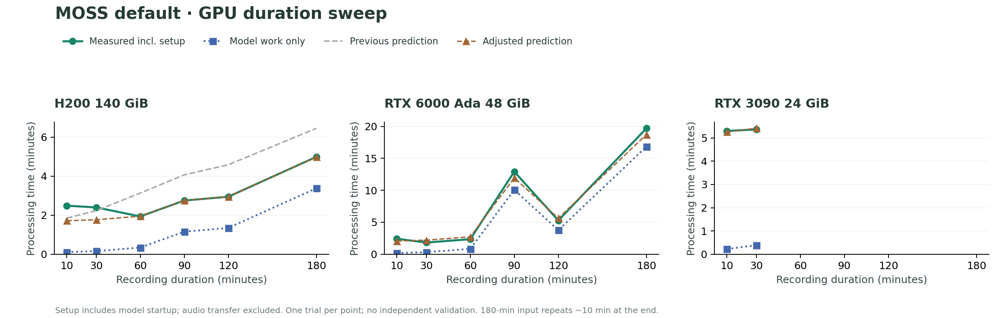

# MOSS 기본 서버 길이별 측정 · 2026-11-10

MOSS SGLang + Nemotron의 기본 처리 경로를 그대로 사용했습니다. Qwen, 양자화, 동시 요청 수 변경, 전사 모델 교체는 하지 않았습니다. 매 조건은 새 프로세스에서 한 번씩 실행하며, 각 서버의 서로 다른 GPU 두 개까지 병렬로 사용했습니다. 측정 당시의 GPU UUID 잠금·VRAM 70% 보호 한도·작업 종료 정리를 그대로 적용했습니다. 아래 RTX 3090 중단은 이 보호 한도를 넘은 결과이며 실제 CUDA OOM을 확인한 결과가 아닙니다. 이후 로컬 앱에서는 이 강제 중단 기준을 제거하고 예상 메모리 경고만 남겼습니다.

## 완료된 결과

단위는 초이며 총시간에 모델 로딩·전환을 포함합니다. 음성 전송·로컬 변환은 제외합니다.

| 녹음 길이 | H200 총시간 | Ada 총시간 | RTX 3090 |
| --- | ---: | ---: | --- |
| 10분 | 149.2 | 145.1 | 317.8 |
| 30분 | 143.9 | 109.6 | 321.8 |
| 60분 | 116.2 | 141.1 | 메모리 보호 한도 초과 |
| 90분 | 165.0 | 775.1 | 메모리 보호 한도 초과 |
| 120분 | 176.7 | 316.9 | 짧은 조건 실패로 미실행 |
| 180분 | 299.2 | 1181.3 | 짧은 조건 실패로 미실행 |

H200·Ada의 120분·180분은 실제 앱처럼 각각 60분×2·90분×2로 순차 전사했습니다. 모델을 구간마다 새로 로딩하지 않습니다. 성공하지 않은 조건의 시간을 만들어 채우거나 다른 GPU의 속도로 대체하지 않습니다. Ada 180분의 감시 시간 초과·연결 중단 시도는 제외하고 완료한 재시도만 반영했습니다.

## 자료와 측정 범위

- 같은 녹음 묶음의 동일한 앞부분을 모든 GPU에서 사용합니다. 실제 자료 약 169분 41초를 이어붙였으며, 180분 조건에서만 앞부분 약 10분 19초를 마지막에 반복했습니다.
- 음성·전사 본문·녹음 이름은 공개하지 않습니다. 수치 자료는 [JSON](2026-11-10-moss-servers.json)에만 보관합니다.
- 모델 로딩, 전사·화자 처리, GPU 프로세스 메모리 피크를 구분해 기록합니다. 첫 프로세스의 CUDA 컴파일·파일 캐시 상태에 따라 로딩 시간이 달라질 수 있습니다. 재부팅 후의 완전한 콜드 스타트 측정은 아닙니다.
- 완료 프로토콜과 앱의 전사 검사를 통과한 결과만 사용했습니다. 사람이 작성한 정답 대본과 정확도를 평가한 실험은 아닙니다.
- GPU별 생성 결과와 누락 구간 보완 횟수가 달랐습니다. 예를 들어 Ada 90분·180분의 최종 요청 수는 각각 2회·5회였으며, 보완 처리 시간도 실측에 포함합니다. 길이뿐 아니라 생성된 발화량과 보완 횟수도 처리 시간에 영향을 줍니다.
- 입력 한 묶음에서 길이당 한 번 측정한 자료입니다. 발화량·내용이 다른 녹음이나 독립된 검증 구간으로 정확도를 확인하지 않았으므로 임시 보정으로 표시합니다.

## 보정 방식

GPU 이름·VRAM 용량·MOSS 실행 환경이 일치하는 프로필만 선택합니다. 완료한 단일 문맥 길이는 처리 시간의 구간별 보간을 사용하며, 준비 시간은 해당 GPU 측정의 중앙값을 한 번만 더합니다. 120·180분처럼 실제 분할한 작업의 처리 시간은 별도 곡선에 저장해 단일 문맥 기록과 섞지 않습니다. 기존 다른 전사 모델의 보정 자료는 유지합니다.

일상적인 완료 기록은 같은 모델·실행 환경·GPU·동시 처리 수·분할 수와 유사 길이에서만 우선 반영합니다. 측정 범위를 벗어나면 범위 밖 추정으로 표시합니다. RTX 3090의 실측 범위는 10·30분뿐이며 더 긴 녹음의 예측을 검증한 자료로 해석하면 안 됩니다.

## 재현

`scripts/measure-moss-servers.py`는 준비된 서버 환경과 명시한 녹음으로 실제 기본 파이프라인을 실행하고, `scripts/summarize-moss-servers.py --apply`는 완료된 수치만 반영해 그래프와 임시 GPU 프로필을 내보냅니다. 임시 WAV·원격 작업 폴더는 작업 종료 시 삭제합니다. 이미 진행 중인 다른 사용자의 GPU 작업은 중단하지 않습니다. H200의 `GPU0`~`GPU3` 더미는 사용자가 사용을 허용한 경우에만 허용합니다.
